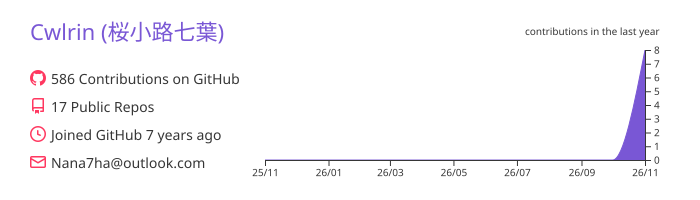
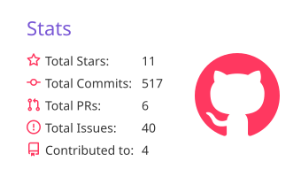

---
<p align="center">
  
</p>

---
<p align="center">
  
</p>

<p align="center">
  
  
</p>

<!--START_SECTION:waka-->
📊 **This Week I Spent My Time On**

```text
🕑︎ Time Zone: Asia/Hong_Kong

💬 Programming Languages: 
Other                     13 hrs 55 mins      ██████████████████████░░░    86.70 % 
Markdown                  2 hrs 8 mins        ███░░░░░░░░░░░░░░░░░░░░░░    13.30 % 

🔥 Editors: 
Edge                      15 hrs 4 mins       ███████████████████████░░    93.83 % 
DSHTauri                  59 mins             ██░░░░░░░░░░░░░░░░░░░░░░░     6.17 % 

💻 Operating System: 
Windows                   16 hrs 3 mins       █████████████████████████   100.00 % 
```

 Last Updated on 11/15/2026 11:28:21 UTC
<!--END_SECTION:waka-->
